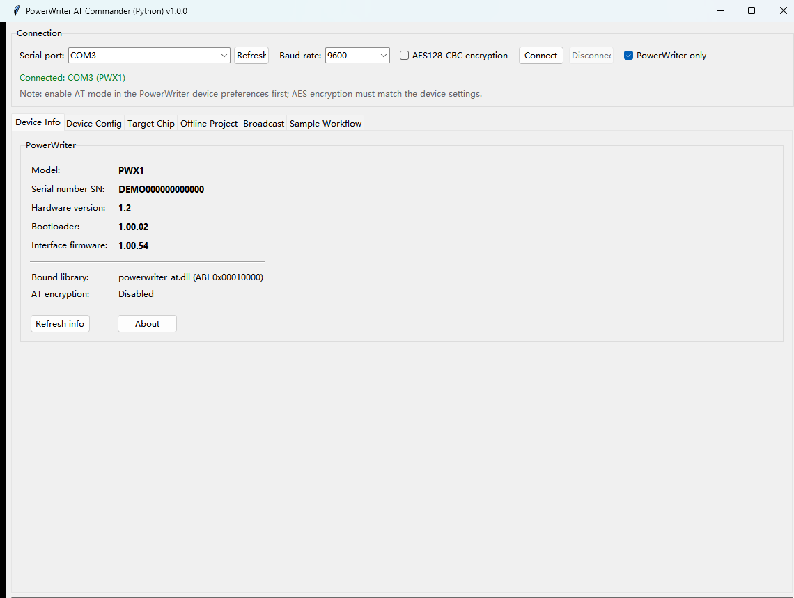
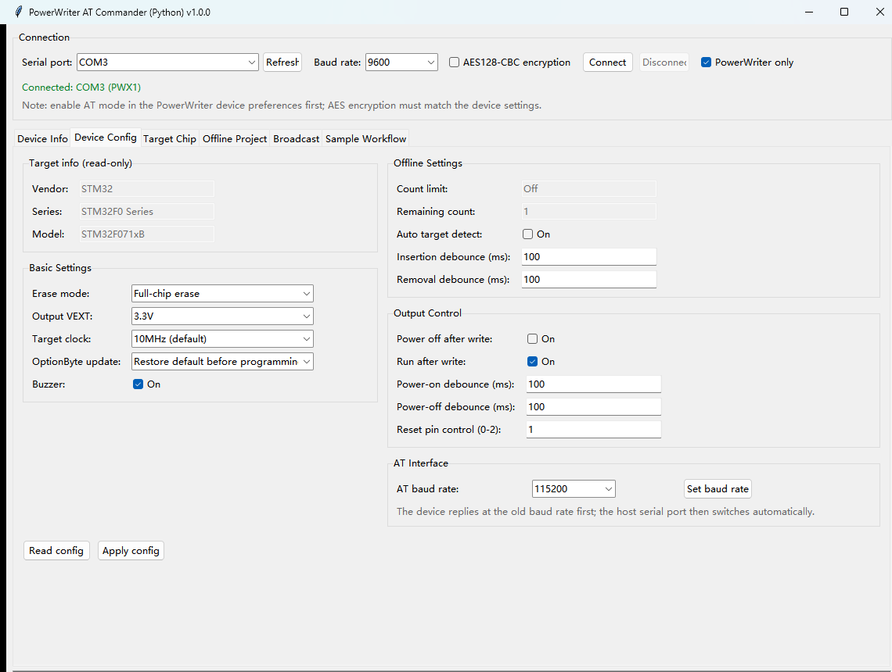
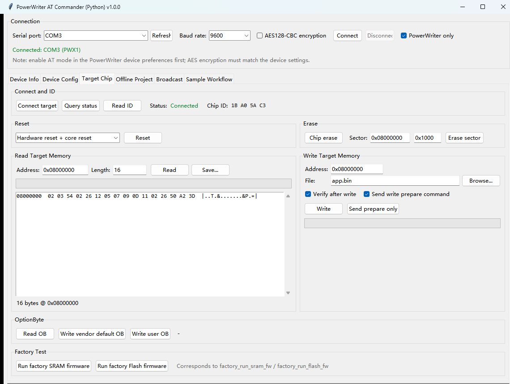
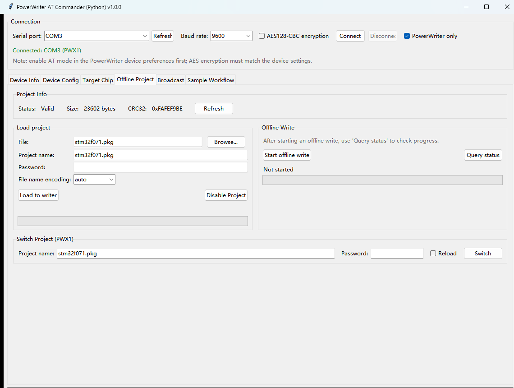
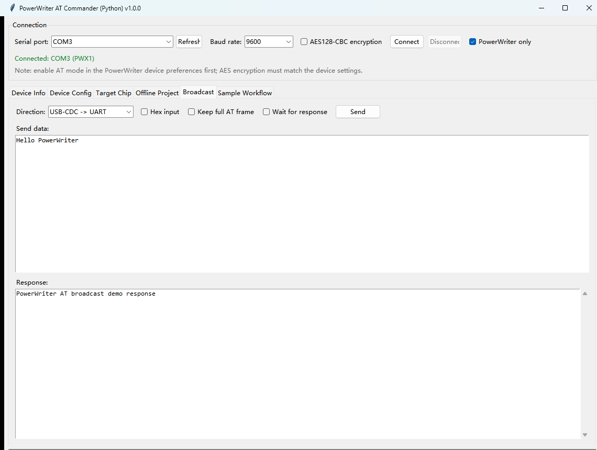
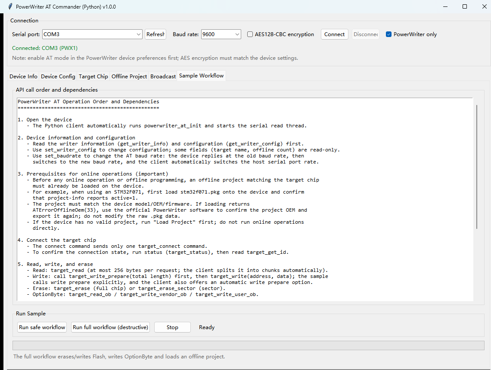

# PowerWriter AT Commander (Python Edition) User Manual

Version: 1.0.0

This manual covers:

- `powerwriter_at_cli_python.exe` - command-line interface
- `powerwriter_at_gui_python.exe` - graphical interface

Both programs are self-contained Windows x64 executables. Python does not need to
be installed on the target computer. The executables and the bundled
`powerwriter_at.dll` are Authenticode-signed by ICWORKSHOP Technology (Shenzhen)
Co., Ltd.

---

## 1. Overview

PowerWriter AT Commander controls a PowerWriter programmer through the PowerWriter
AT protocol. It supports:

- writer information and configuration;
- target connection, chip ID and memory read/write;
- chip/sector erase, OptionByte read/write and target reset;
- offline project load, query, switch, disable and offline programming;
- broadcast and factory firmware commands;
- a sample workflow that follows `powerwriter_at_samples.c`.

The CLI supports two equivalent styles:

1. **C++ CLI compatible flat flags** - for example `-info`, `-read -addr ... -s ...`
2. **Subcommands** - for example `info`, `read ...`

The GUI exposes the same functions through tabs and buttons.

---

## 2. Package Contents

| File | Purpose |
|---|---|
| `powerwriter_at_cli_python.exe` | Command-line program |
| `powerwriter_at_gui_python.exe` | Graphical program |
| `powerwriter_at.dll` | PowerWriter AT C library (normally bundled inside the executables) |
| `assets/powerwriter_at_demo_project.pkg` | Demo offline project |

The one-file executables extract their bundled files to a temporary directory at
run time. No external runtime, Python, pip, pyserial or Visual C++ redistributable
is required.

---

## 3. Preparation

1. Connect the PowerWriter device to the PC with a USB cable.
2. Open the PowerWriter device preferences and **enable AT mode**.
3. Close the official PowerWriter application and any other program that may be
   using the same COM port.
4. Identify the correct COM port. The default PowerWriter USB ID is
   `VID 0D28 / PID 0204`.
5. Verify that the offline project stored in the device matches the target chip.

> **Safety:** erase, write, OptionByte write, project load and offline
> programming modify the target chip or the writer. Confirm the chip type and
> project before running destructive commands. Do not use a mismatched project.

---

## 4. Command-Line Interface

### 4.1 Start and help

```bat
powerwriter_at_cli_python.exe --help
powerwriter_at_cli_python.exe -help
powerwriter_at_cli_python.exe --version
```

`--help` lists the subcommands. `-help` lists the C++-style flat flags.

### 4.2 Global options

| Option | Description |
|---|---|
| `--port COMx` | Serial port. If omitted, the program auto-selects a single PowerWriter. |
| `--baud N` | Host serial baud rate. Default: `9600`. USB-CDC ignores this value. |
| `--encrypt` | Enable AES128-CBC encrypted communication. Must match the device. |
| `--debug` | Print AT frame transmit/receive debug logs. |
| `--quiet` | Print warnings and errors only. |
| `-V`, `--version` | Show the program version. |

Global options can appear before or after a subcommand. In flat-flag mode they
can appear anywhere in the argument list.

### 4.3 Port discovery

```bat
powerwriter_at_cli_python.exe list
powerwriter_at_cli_python.exe list --powerwriter
powerwriter_at_cli_python.exe doctor
powerwriter_at_cli_python.exe -scan
```

`list --powerwriter` and `-scan` show PowerWriter devices identified by USB
VID/PID or description. `doctor` also checks the shared library and platform.

### 4.4 C++-style flat commands

| Command | Description |
|---|---|
| `-info` | Read writer information |
| `-cfg` | Read writer configuration |
| `-setcfg -f FILE` | Write configuration from a JSON file |
| `-setbaud -b BAUD` | Set the device AT baud rate |
| `-connect` | Send the target connect command (one command only) |
| `-status` | Query target status; polls for up to 5 seconds |
| `-cid` | Read target chip ID |
| `-read -addr ADDR -s SIZE` | Read target memory |
| `-erase -t MS` | Full-chip erase |
| `-erase -t MS -addr ADDR -s SIZE` | Sector erase |
| `-write -addr ADDR -f FILE` | Write target memory (`.bin` only) |
| `-read-ob` | Read target OptionByte |
| `-write-vob -t MS` | Write vendor default OptionByte |
| `-write-uob -t MS` | Write user OptionByte |
| `-reset -type TYPE` | Reset the target (default type: 3) |
| `-prj-info` | Query offline project information |
| `-prj-ld -f FILE [-pwd PWD]` | Load an offline project |
| `-prj-sw -mode 0\|1 -f FILE [-pwd PWD]` | Switch offline project; `1` reloads |
| `-prj-dis` | Disable the offline project |
| `-start` | Start offline programming |
| `-offline-status` | Query offline programming status once |
| `-factory-sram-fw -t MS` | Run factory SRAM firmware |
| `-factory-flash-fw -t MS` | Run factory Flash firmware |
| `-bcst -data TEXT -dir DIR` | Broadcast text |
| `-bcst -f FILE -dir DIR` | Broadcast a `.txt` or `.bin` file |
| `-sleep -t MS` | Wait on the host; no device command is sent |
| `-scan` | Scan for PowerWriter devices |

Flat parameters:

| Parameter | Meaning |
|---|---|
| `-f FILE` | File path |
| `-pwd PWD` | Project password |
| `-b BAUD` | Baud rate |
| `-type N` | Reset type |
| `-addr N` | Address |
| `-s N` | Length |
| `-t MS` | Timeout in milliseconds |
| `-data S` | Broadcast text |
| `-dir S` | Broadcast direction: `usbtouart` or `uarttousb` |
| `-kf true\|false` | Forward the complete AT frame |
| `-wtrsp true\|false` | Wait for a broadcast response |
| `-mode N` | `0` = continue, `1` = reload |
| `-fw-num N` | Accepted but ignored; the Python edition writes `.bin` only |

Examples:

```bat
powerwriter_at_cli_python.exe --port COM3 -info
powerwriter_at_cli_python.exe --port COM3 -read -addr 0x08000000 -s 0x100
powerwriter_at_cli_python.exe --port COM3 -write -addr 0x08000000 -f app.bin
powerwriter_at_cli_python.exe --port COM3 -erase -t 10000
powerwriter_at_cli_python.exe --port COM3 -erase -t 10000 -addr 0x08000000 -s 0x1000
powerwriter_at_cli_python.exe --port COM3 -prj-ld -f stm32f071.pkg
powerwriter_at_cli_python.exe --port COM3 -prj-info
powerwriter_at_cli_python.exe --port COM3 -connect
powerwriter_at_cli_python.exe --port COM3 -status
powerwriter_at_cli_python.exe --port COM3 -cid
powerwriter_at_cli_python.exe --port COM3 -start
powerwriter_at_cli_python.exe --port COM3 -offline-status
```

### 4.5 Subcommand style

| Command | Syntax | Description |
|---|---|---|
| `list` | `list [--powerwriter]` | List serial ports |
| `doctor` | `doctor` | Check library, platform and ports |
| `about` | `about` | Show interface information |
| `guide` | `guide` | Show call order and dependencies |
| `info` | `info [--config]` | Read writer information; optionally config |
| `config-get` | `config-get` | Read writer configuration |
| `config-set` | `config-set [options]` | Modify writer configuration |
| `set-baud` | `set-baud BAUD` | Set device AT baud rate |
| `connect` | `connect` | Send target connect command |
| `status` | `status` | Query target status (poll up to 5 s) |
| `id` | `id` | Read target chip ID |
| `read` | `read ADDRESS SIZE [-o FILE]` | Read memory |
| `write` | `write ADDRESS FILE [--verify] [--no-prepare] [-y]` | Write memory |
| `write-prepare` | `write-prepare TOTAL` | Send write-prepare |
| `erase` | `erase [--timeout MS] [-y]` | Full-chip erase |
| `erase-sector` | `erase-sector ADDRESS SIZE [--timeout MS] [-y]` | Sector erase |
| `ob-read` | `ob-read [-o FILE]` | Read OptionByte |
| `ob-write-vendor` | `ob-write-vendor [--timeout MS] [-y]` | Write vendor default OptionByte |
| `ob-write-user` | `ob-write-user [--timeout MS] [-y]` | Write user OptionByte |
| `reset` | `reset [--type TYPE]` | Reset target |
| `project-info` | `project-info` | Query offline project |
| `project-load` | `project-load FILE [--name NAME] [--password PWD] [--name-encoding ENC] [-y]` | Load project |
| `project-disable` | `project-disable [-y]` | Disable project |
| `offline-start` | `offline-start [-y]` | Start offline programming |
| `offline-status` | `offline-status` | Query status once |
| `project-switch` | `project-switch NAME [--password PWD] [--reload] [--name-encoding ENC]` | Switch project |
| `broadcast` | `broadcast DATA [--hex] [--dir DIR] [--keep-frame] [--wait-rsp] [--timeout MS]` | Broadcast |
| `factory-sram` | `factory-sram [--timeout MS]` | Run factory SRAM firmware |
| `factory-flash` | `factory-flash [--timeout MS]` | Run factory Flash firmware |
| `benchmark` | `benchmark [--destructive] [-y] [--project FILE]` | Sample workflow |

`config-set` options:

```text
--erase-type {none,chip,sector}
--vext {1.8,3.3,5.0,external}
--clock {1,2,5,10,20}
--buzzer {on,off,1,0}
--ob-update {0,1,2,3}
--auto {on,off,1,0}
--in-debounce MS --out-debounce MS
--disable-power-ap {on,off,1,0}
--run-ap {on,off,1,0}
--power-on-debounce MS --power-off-debounce MS
--reset-pin {0,1,2}
```

Examples:

```bat
powerwriter_at_cli_python.exe --port COM3 info
powerwriter_at_cli_python.exe --port COM3 config-get
powerwriter_at_cli_python.exe --port COM3 read 0x08000000 256
powerwriter_at_cli_python.exe --port COM3 write 0x08000000 app.bin -y
powerwriter_at_cli_python.exe --port COM3 project-load stm32f071.pkg -y
powerwriter_at_cli_python.exe --port COM3 project-info
powerwriter_at_cli_python.exe --port COM3 connect
powerwriter_at_cli_python.exe --port COM3 status
powerwriter_at_cli_python.exe --port COM3 offline-start -y
powerwriter_at_cli_python.exe --port COM3 offline-status
```

### 4.6 Recommended project workflow

1. Load the offline project that matches the target chip:

   ```bat
   powerwriter_at_cli_python.exe --port COM3 project-load stm32f071.pkg -y
   ```

2. Confirm that the project is valid:

   ```bat
   powerwriter_at_cli_python.exe --port COM3 project-info
   ```

   The output should show `Project status: valid` and the expected size and CRC32.

3. Connect and verify the target:

   ```bat
   powerwriter_at_cli_python.exe --port COM3 connect
   powerwriter_at_cli_python.exe --port COM3 status
   powerwriter_at_cli_python.exe --port COM3 id
   ```

4. Read, write, erase or update OptionByte as required.

5. For offline programming, start the job and query its status separately:

   ```bat
   powerwriter_at_cli_python.exe --port COM3 offline-start -y
   powerwriter_at_cli_python.exe --port COM3 offline-status
   ```

### 4.7 `-setcfg` JSON example

```json
{
  "names": {
    "vendor": "STM32",
    "series": "STM32F0 Series",
    "model": "STM32F071xB"
  },
  "base config": {
    "erase": 1,
    "vext": 1,
    "clock": 1,
    "buzzer": false,
    "option byte type": 3
  },
  "offline config": {
    "limit enable": false,
    "limit number": 1,
    "auto": false,
    "in debounce(ms)": 250,
    "out debounce(ms)": 250
  },
  "output config": {
    "disable power after programming": false,
    "run target after programming": true,
    "power on debounce(ms)": 100,
    "power off debounce(ms)": 100,
    "reset pin ctrl": 1
  }
}
```

### 4.8 Behavior notes

- **Flat mode executes immediately.** It does not ask for confirmation. Use it
  only when you are sure about the target and project.
- **Subcommand mode protects destructive operations.** Add `-y` or `--yes` to
  skip the confirmation prompt.
- `connect` sends only the target connect command. Use `status` to query the
  target state.
- `status` polls for up to 5 seconds.
- `offline-start` only starts the job. Use `offline-status` to query progress.
- `write` in the Python edition supports `.bin` files only. The flat `-fw-num`
  parameter is accepted but ignored.
- Broadcast data is split into 256-byte packets automatically.
- C++ direction names map as follows:
  - `usbtouart` = `cdc2uart`
  - `uarttousb` = `uart2cdc`
- If `--port` is omitted, the program auto-selects the only detected PowerWriter.

---

## 5. Graphical Interface

Start the GUI:

```bat
powerwriter_at_gui_python.exe
```

### 5.1 Connection bar

| Control | Description |
|---|---|
| `Serial port` | Port selection |
| `Refresh` | Rescan serial ports |
| `Baud rate` | Host baud rate; default `9600` |
| `AES128-CBC encryption` | Enable encrypted communication |
| `Connect` / `Disconnect` | Open or close the serial port |
| `PowerWriter only` | Show only detected PowerWriter devices |
| Status line | Connection and operation status |

Enable AT mode in the PowerWriter device preferences and close other serial
applications before connecting.

### 5.2 Tabs

#### Device Info

Shows model, serial number, hardware version, bootloader version, interface
version, bound library and encryption state. Buttons: `Refresh info`, `About`.

#### Device Config

- `Target info (read-only)`: vendor, series and model.
- `Basic Settings`: erase mode, VEXT, clock, buzzer and OptionByte update mode.
- `Offline Settings`: target auto-detect and debounce times.
- `Output Control`: power-off/run-after-programming and debounce times.
- `AT Interface`: set the AT baud rate.
- Buttons: `Read config`, `Apply config`, `Set baud rate`.

#### Target Chip

- `Connect target`, `Query status`, `Read ID`.
- `Reset`.
- `Erase`: `Chip erase`, sector address/length, `Erase sector`.
- `Read Target Memory`: address, length, `Read`, `Save...`.
- `Write Target Memory`: address, file, `Browse...`, verify/prepare options,
  `Write`, `Send prepare only`.
- `OptionByte`: `Read OB`, `Write vendor default OB`, `Write user OB`.
- `Factory Test`: `Run factory SRAM firmware`, `Run factory Flash firmware`.

#### Offline Project

- `Project Info`: status, size, CRC32, `Refresh`.
- `Load project`: file, project name, password, file-name encoding,
  `Load to writer`, `Disable Project`.
- `Offline Write`: `Start offline write`, `Query status`.
- `Switch Project (PWX1)`: project name, password, reload option, `Switch`.

#### Broadcast

Select direction, enter text or hexadecimal data, optionally keep the full AT
frame or wait for a response, then click `Send`. The response is shown below.

#### Sample Workflow

Provides `Run safe workflow` (read-only steps) and
`Run full workflow (destructive)` (erase/write/OptionByte/project/offline steps).
`Stop` requests a stop between steps. The full workflow modifies the target.

#### Log

Shows operation and communication logs. `Clear` clears the pane; `Save log...`
writes the log to a file.

### 5.3 Recommended GUI workflow

1. Select the PowerWriter port and click `Connect`.
2. Open `Offline Project`, choose the matching `.pkg`, click `Load to writer`,
   then `Refresh` and confirm `Status: Valid`.
3. Open `Target Chip`, click `Connect target` and `Query status`.
4. Use `Read Target Memory`, `Write Target Memory`, `Erase` or `OptionByte`
   as required.
5. For offline programming, use `Offline Write` -> `Start offline write`, then
   `Query status`.
6. Use `Broadcast` or `Factory Test` only when required by your target/project.

---

## 6. Demo Walkthrough

The screenshots below use simulated device data (COM3, PWX1, demo serial number,
`stm32f071.pkg`). They do not contain a real device serial number.

### 6.1 GUI tour

**Figure 1 - Device Info tab**



**Figure 2 - Device Config tab**



**Figure 3 - Target Chip tab**



**Figure 4 - Offline Project tab**



**Figure 5 - Broadcast tab**



**Figure 6 - Sample Workflow tab**



### 6.2 Demo 1 - Read writer information

GUI:

1. Select the PowerWriter serial port and click `Connect`.
2. Open `Device Info`; the model, serial number, hardware, bootloader and
   interface versions are shown (Figure 1).
3. Open `Device Config` and click `Read config` to read the current settings
   (Figure 2).

CLI:

```bat
powerwriter_at_cli_python.exe --port COM3 info
powerwriter_at_cli_python.exe --port COM3 config-get
```

Example output:

```text
Model: PWX1 | SN: <SN> | Hardware: 1.2 | Bootloader: 1.00.02 | Interface firmware: 1.00.54
```

```text
Target chip: STM32 / STM32F0 Series / STM32F071xB
Erase mode: Full-chip erase
Output VEXT: 3.3V
Target clock: 10MHz (default)
```

### 6.3 Demo 2 - Load and verify an offline project

GUI:

1. Open `Offline Project`.
2. Click `Browse...` and select `stm32f071.pkg`.
3. Click `Load to writer`.
4. Click `Refresh` and verify:
   - `Status: Valid`
   - `Size: 23602 bytes`
   - `CRC32: 0xFAFEF9BE`

See Figure 4.

CLI:

```bat
powerwriter_at_cli_python.exe --port COM3 project-load stm32f071.pkg -y
powerwriter_at_cli_python.exe --port COM3 project-info
```

Example output:

```text
Project status: valid
Project size: 23602 bytes
CRC32   : 0xFAFEF9BE
```

### 6.4 Demo 3 - Connect and read target memory

GUI:

1. Open `Target Chip`.
2. Click `Connect target`.
3. Click `Query status`; the status should become `Connected`.
4. Click `Read ID` (example result: `1B A0 5A C3`).
5. Enter `0x08000000` and `16`, then click `Read`.

See Figure 3.

CLI:

```bat
powerwriter_at_cli_python.exe --port COM3 connect
powerwriter_at_cli_python.exe --port COM3 status
powerwriter_at_cli_python.exe --port COM3 id
powerwriter_at_cli_python.exe --port COM3 read 0x08000000 16
```

Example output:

```text
Target chip connected
Chip ID: 1B A0 5A C3
08000000  FF FF FF FF FF FF FF FF FF FF FF FF FF FF FF FF  |................|
```

### 6.5 Demo 4 - Offline programming

GUI:

1. Confirm that the project status is `Valid`.
2. Open `Offline Project` -> `Offline Write`.
3. Click `Start offline write`.
4. Click `Query status` and wait until the status reports completion.

See Figure 4.

CLI:

```bat
powerwriter_at_cli_python.exe --port COM3 offline-start -y
powerwriter_at_cli_python.exe --port COM3 offline-status
```

Example output:

```text
Offline programming started
```

```text
Offline programming complete
```

### 6.6 Demo 5 - Broadcast and sample workflow

GUI:

1. Open `Broadcast`, select the direction, enter `Hello PowerWriter`, then click
   `Send` (Figure 5).
2. Open `Sample Workflow`; run `Run safe workflow` for read-only steps, or
   `Run full workflow (destructive)` after confirming the target and project
   (Figure 6).

CLI:

```bat
powerwriter_at_cli_python.exe --port COM3 broadcast "Hello PowerWriter" --dir cdc2uart
```

For destructive experiments, use the sample workflow only on a test chip:

```bat
powerwriter_at_cli_python.exe --port COM3 benchmark
powerwriter_at_cli_python.exe --port COM3 benchmark --destructive -y
```

## 7. Troubleshooting

| Symptom | Check |
|---|---|
| No serial port found | USB cable, driver, AT mode, `PowerWriter only` filter |
| Access denied | Close the official PowerWriter application and other serial tools |
| `Offline project is disabled` | Load a valid project and confirm `Status: Valid` |
| `Invalid offline project OEM` | Project does not match the device; export a matching project with the official PowerWriter software |
| `Target chip not connected` | Target power/wiring, click `Connect target`, then `Query status` |
| Operation timed out | Confirm the device is responsive, the project is valid and the target is connected; reconnect the USB cable if necessary |
| Broadcast has no response | Check direction and whether the AT UART feature is enabled on the device |
| AES communication fails | Enable encryption only when the device uses the same AES settings |
| Windows SmartScreen warning | Verify that the publisher is ICWORKSHOP Technology (Shenzhen) Co., Ltd. |

---

## 8. Safety and Best Practices

- Confirm the target chip and offline project before erase, write, OptionByte or
  offline programming.
- Do not interrupt an erase, write or offline programming operation.
- Do not load a project exported for a different device model or OEM.
- Keep a backup of important target firmware.
- Use the correct VEXT and clock settings for the target board.
- For OTP or protected chips, verify the erase/write behavior before use.

---

## 9. Version and Support

- Product: PowerWriter AT Commander, Python edition
- Version: 1.0.0
- Executables: `powerwriter_at_cli_python.exe`, `powerwriter_at_gui_python.exe`
- Documentation: PowerWriter AT Command reference
  <https://docs.powerwriter.com/docs/powerwriter_for_arm/reference/ATCommand>
- Technical support: <csh@icworkshop.com>
- Website: <https://www.icworkshop.com> / <https://www.powerwriter.com>
