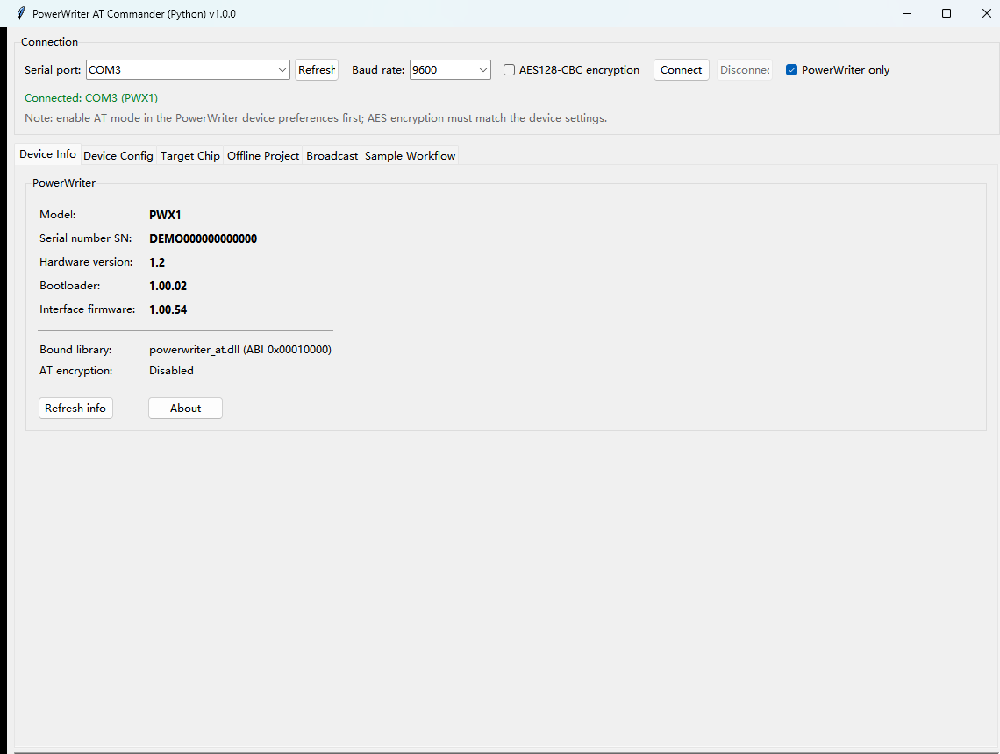
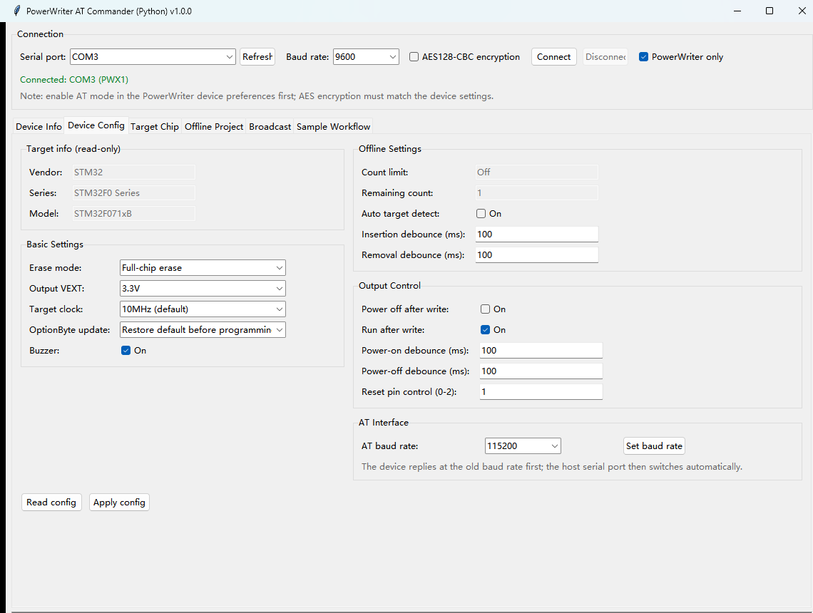
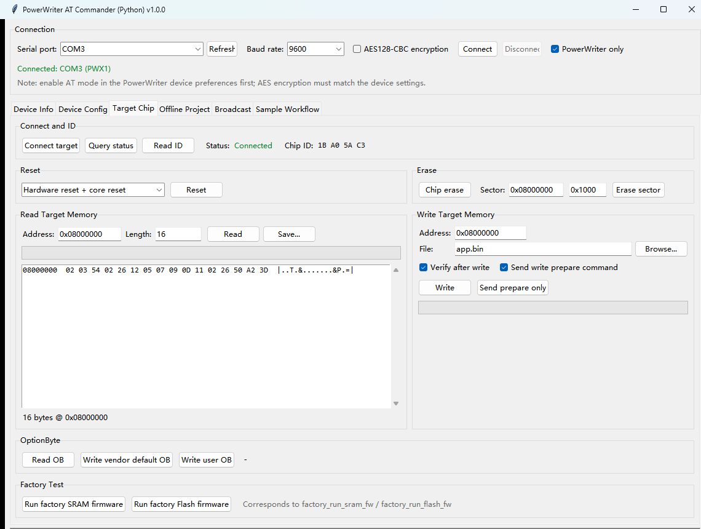
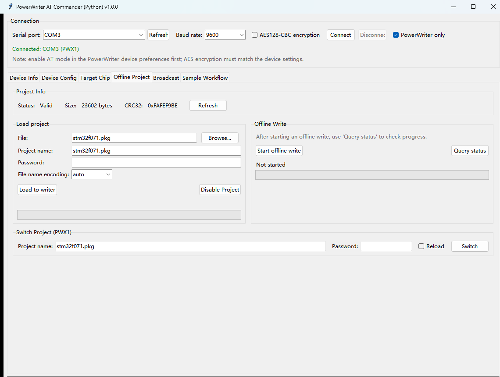
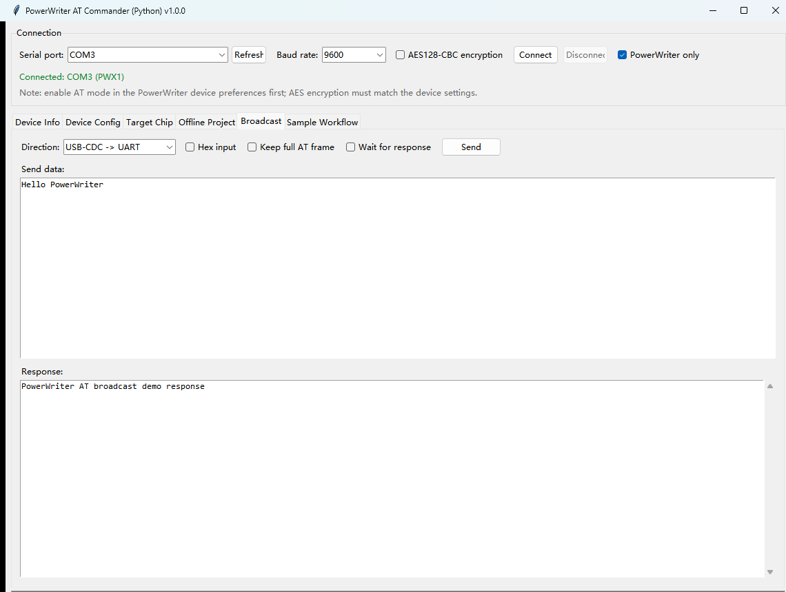
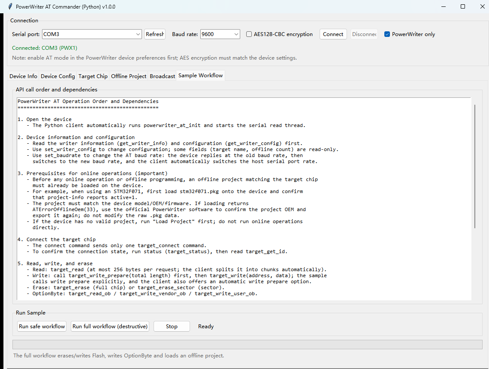

# PowerWriter AT Commander（Python 版）用户手册

版本：1.0.0

本手册适用于：

- `powerwriter_at_cli_python.exe`：命令行版本
- `powerwriter_at_gui_python.exe`：图形界面版本

两个程序都是 Windows x64 自包含 EXE，目标电脑不需要安装 Python。EXE 以及
内置的 `powerwriter_at.dll` 已由 ICWORKSHOP Technology (Shenzhen) Co., Ltd.
进行 Authenticode 签名。

---

## 1. 功能概览

PowerWriter AT Commander 通过 PowerWriter AT 协议控制 PowerWriter 烧录器，
支持：

- 读取烧录器信息和配置；
- 连接目标芯片、读取芯片 ID、读写目标内存；
- 全片/扇区擦除、OptionByte 读写、目标复位；
- 离线工程加载、查询、切换、禁用和离线烧录；
- 广播和工厂固件命令；
- 对应 `powerwriter_at_samples.c` 的示例流程。

CLI 支持两种等价写法：

1. **C++ CLI 风格扁平参数**：例如 `-info`、`-read -addr ... -s ...`
2. **子命令风格**：例如 `info`、`read ...`

GUI 通过标签页和按钮提供相同功能。

---

## 2. 文件说明

| 文件 | 用途 |
|---|---|
| `powerwriter_at_cli_python.exe` | 命令行程序 |
| `powerwriter_at_gui_python.exe` | 图形界面程序 |
| `powerwriter_at.dll` | PowerWriter AT C 库（通常已内置在 EXE 中） |
| `assets/powerwriter_at_demo_project.pkg` | 演示离线工程 |

单文件 EXE 运行时会把内置文件解压到临时目录。目标电脑无需安装 Python、pip、
pyserial 或 Visual C++ 运行库。

---

## 3. 使用前准备

1. 使用 USB 线连接 PowerWriter 烧录器。
2. 在 PowerWriter 设备首选项中**开启 AT 模式**。
3. 关闭官方 PowerWriter 软件以及其他可能占用同一 COM 口的程序。
4. 确认串口号。PowerWriter 默认 USB 标识为 `VID 0D28 / PID 0204`。
5. 确认设备中的离线工程与目标芯片匹配。

> **安全提示：** 擦除、写入、写 OptionByte、加载工程和离线烧录会修改目标芯片
> 或烧录器数据。执行前请确认芯片型号和工程文件；不要加载不匹配的工程。

---

## 4. 命令行版本

### 4.1 帮助和版本

```bat
powerwriter_at_cli_python.exe --help
powerwriter_at_cli_python.exe -help
powerwriter_at_cli_python.exe --version
```

`--help` 显示子命令；`-help` 显示 C++ 风格扁平参数。

### 4.2 全局选项

| 选项 | 说明 |
|---|---|
| `--port COMx` | 指定串口；不指定时自动选择唯一的 PowerWriter |
| `--baud N` | 主机串口波特率，默认 `9600`；USB-CDC 可忽略 |
| `--encrypt` | 启用 AES128-CBC 加密通信，必须与设备设置一致 |
| `--debug` | 输出 AT 帧收发调试日志 |
| `--quiet` | 只输出警告和错误 |
| `-V`、`--version` | 显示版本 |

全局选项可以写在子命令前后；扁平参数模式下可以写在任意位置。

### 4.3 查找设备

```bat
powerwriter_at_cli_python.exe list
powerwriter_at_cli_python.exe list --powerwriter
powerwriter_at_cli_python.exe doctor
powerwriter_at_cli_python.exe -scan
```

`list --powerwriter` 和 `-scan` 会根据 USB VID/PID 或描述识别 PowerWriter。
`doctor` 还会检查动态库和平台环境。

### 4.4 C++ 风格扁平参数

| 命令 | 说明 |
|---|---|
| `-info` | 读取烧录器信息 |
| `-cfg` | 读取烧录器配置 |
| `-setcfg -f FILE` | 从 JSON 文件写入配置 |
| `-setbaud -b BAUD` | 设置设备 AT 波特率 |
| `-connect` | 发送连接目标命令（只发这一条命令） |
| `-status` | 查询目标状态，最多轮询 5 秒 |
| `-cid` | 读取目标芯片 ID |
| `-read -addr ADDR -s SIZE` | 读取目标内存 |
| `-erase -t MS` | 全片擦除 |
| `-erase -t MS -addr ADDR -s SIZE` | 扇区擦除 |
| `-write -addr ADDR -f FILE` | 写入目标内存（当前仅支持 `.bin`） |
| `-read-ob` | 读取目标 OptionByte |
| `-write-vob -t MS` | 写厂商默认 OptionByte |
| `-write-uob -t MS` | 写用户 OptionByte |
| `-reset -type TYPE` | 复位目标，默认类型 3 |
| `-prj-info` | 查询离线工程信息 |
| `-prj-ld -f FILE [-pwd PWD]` | 加载离线工程 |
| `-prj-sw -mode 0\|1 -f FILE [-pwd PWD]` | 切换工程，`1` 表示重新加载 |
| `-prj-dis` | 禁用离线工程 |
| `-start` | 启动离线烧录 |
| `-offline-status` | 查询一次离线烧录状态 |
| `-factory-sram-fw -t MS` | 运行工厂 SRAM 固件 |
| `-factory-flash-fw -t MS` | 运行工厂 Flash 固件 |
| `-bcst -data TEXT -dir DIR` | 广播文本 |
| `-bcst -f FILE -dir DIR` | 广播 `.txt` 或 `.bin` 文件 |
| `-sleep -t MS` | 主机等待，不发送设备命令 |
| `-scan` | 扫描 PowerWriter 设备 |

扁平参数：

| 参数 | 含义 |
|---|---|
| `-f FILE` | 文件路径 |
| `-pwd PWD` | 工程密码 |
| `-b BAUD` | 波特率 |
| `-type N` | 复位类型 |
| `-addr N` | 地址 |
| `-s N` | 长度 |
| `-t MS` | 超时（毫秒） |
| `-data S` | 广播文本 |
| `-dir S` | 广播方向：`usbtouart` 或 `uarttousb` |
| `-kf true\|false` | 是否转发完整 AT 帧 |
| `-wtrsp true\|false` | 是否等待广播响应 |
| `-mode N` | `0` 继续，`1` 重新加载 |
| `-fw-num N` | 保留参数；Python 版仅写 `.bin`，此参数被忽略 |

示例：

```bat
powerwriter_at_cli_python.exe --port COM3 -info
powerwriter_at_cli_python.exe --port COM3 -read -addr 0x08000000 -s 0x100
powerwriter_at_cli_python.exe --port COM3 -write -addr 0x08000000 -f app.bin
powerwriter_at_cli_python.exe --port COM3 -erase -t 10000
powerwriter_at_cli_python.exe --port COM3 -erase -t 10000 -addr 0x08000000 -s 0x1000
powerwriter_at_cli_python.exe --port COM3 -prj-ld -f stm32f071.pkg
powerwriter_at_cli_python.exe --port COM3 -prj-info
powerwriter_at_cli_python.exe --port COM3 -connect
powerwriter_at_cli_python.exe --port COM3 -status
powerwriter_at_cli_python.exe --port COM3 -cid
powerwriter_at_cli_python.exe --port COM3 -start
powerwriter_at_cli_python.exe --port COM3 -offline-status
```

### 4.5 子命令风格

| 命令 | 语法 | 说明 |
|---|---|---|
| `list` | `list [--powerwriter]` | 列出串口 |
| `doctor` | `doctor` | 检查库、平台和串口 |
| `about` | `about` | 显示接口介绍 |
| `guide` | `guide` | 显示 API 调用顺序和依赖 |
| `info` | `info [--config]` | 读取烧录器信息，可选配置 |
| `config-get` | `config-get` | 读取配置 |
| `config-set` | `config-set [选项]` | 修改配置 |
| `set-baud` | `set-baud BAUD` | 设置 AT 波特率 |
| `connect` | `connect` | 发送连接目标命令 |
| `status` | `status` | 查询目标状态（最多 5 秒） |
| `id` | `id` | 读取芯片 ID |
| `read` | `read ADDRESS SIZE [-o FILE]` | 读取内存 |
| `write` | `write ADDRESS FILE [--verify] [--no-prepare] [-y]` | 写内存 |
| `write-prepare` | `write-prepare TOTAL` | 发送写准备 |
| `erase` | `erase [--timeout MS] [-y]` | 全片擦除 |
| `erase-sector` | `erase-sector ADDRESS SIZE [--timeout MS] [-y]` | 扇区擦除 |
| `ob-read` | `ob-read [-o FILE]` | 读 OptionByte |
| `ob-write-vendor` | `ob-write-vendor [--timeout MS] [-y]` | 写厂商默认 OptionByte |
| `ob-write-user` | `ob-write-user [--timeout MS] [-y]` | 写用户 OptionByte |
| `reset` | `reset [--type TYPE]` | 复位目标 |
| `project-info` | `project-info` | 查询离线工程 |
| `project-load` | `project-load FILE [--name NAME] [--password PWD] [--name-encoding ENC] [-y]` | 加载工程 |
| `project-disable` | `project-disable [-y]` | 禁用工程 |
| `offline-start` | `offline-start [-y]` | 启动离线烧录 |
| `offline-status` | `offline-status` | 查询一次状态 |
| `project-switch` | `project-switch NAME [--password PWD] [--reload] [--name-encoding ENC]` | 切换工程 |
| `broadcast` | `broadcast DATA [--hex] [--dir DIR] [--keep-frame] [--wait-rsp] [--timeout MS]` | 广播 |
| `factory-sram` | `factory-sram [--timeout MS]` | 运行工厂 SRAM 固件 |
| `factory-flash` | `factory-flash [--timeout MS]` | 运行工厂 Flash 固件 |
| `benchmark` | `benchmark [--destructive] [-y] [--project FILE]` | 示例流程 |

`config-set` 选项：

```text
--erase-type {none,chip,sector}
--vext {1.8,3.3,5.0,external}
--clock {1,2,5,10,20}
--buzzer {on,off,1,0}
--ob-update {0,1,2,3}
--auto {on,off,1,0}
--in-debounce MS --out-debounce MS
--disable-power-ap {on,off,1,0}
--run-ap {on,off,1,0}
--power-on-debounce MS --power-off-debounce MS
--reset-pin {0,1,2}
```

示例：

```bat
powerwriter_at_cli_python.exe --port COM3 info
powerwriter_at_cli_python.exe --port COM3 config-get
powerwriter_at_cli_python.exe --port COM3 read 0x08000000 256
powerwriter_at_cli_python.exe --port COM3 write 0x08000000 app.bin -y
powerwriter_at_cli_python.exe --port COM3 project-load stm32f071.pkg -y
powerwriter_at_cli_python.exe --port COM3 project-info
powerwriter_at_cli_python.exe --port COM3 connect
powerwriter_at_cli_python.exe --port COM3 status
powerwriter_at_cli_python.exe --port COM3 offline-start -y
powerwriter_at_cli_python.exe --port COM3 offline-status
```

### 4.6 推荐工程流程

1. 加载与目标芯片匹配的离线工程：

   ```bat
   powerwriter_at_cli_python.exe --port COM3 project-load stm32f071.pkg -y
   ```

2. 确认工程有效：

   ```bat
   powerwriter_at_cli_python.exe --port COM3 project-info
   ```

   输出应显示 `Project status: valid`，并给出预期的 size 和 CRC32。

3. 连接并确认目标：

   ```bat
   powerwriter_at_cli_python.exe --port COM3 connect
   powerwriter_at_cli_python.exe --port COM3 status
   powerwriter_at_cli_python.exe --port COM3 id
   ```

4. 按需执行读取、写入、擦除或 OptionByte 操作。

5. 离线烧录时，启动和查询状态是两条独立命令：

   ```bat
   powerwriter_at_cli_python.exe --port COM3 offline-start -y
   powerwriter_at_cli_python.exe --port COM3 offline-status
   ```

### 4.7 `-setcfg` JSON 示例

```json
{
  "names": {
    "vendor": "STM32",
    "series": "STM32F0 Series",
    "model": "STM32F071xB"
  },
  "base config": {
    "erase": 1,
    "vext": 1,
    "clock": 1,
    "buzzer": false,
    "option byte type": 3
  },
  "offline config": {
    "limit enable": false,
    "limit number": 1,
    "auto": false,
    "in debounce(ms)": 250,
    "out debounce(ms)": 250
  },
  "output config": {
    "disable power after programming": false,
    "run target after programming": true,
    "power on debounce(ms)": 100,
    "power off debounce(ms)": 100,
    "reset pin ctrl": 1
  }
}
```

### 4.8 行为说明

- **扁平参数模式直接执行**，不会弹出确认。请确认目标芯片和工程后再使用。
- **子命令模式的破坏性操作需要 `-y` 或 `--yes`**。
- `connect` 只发送连接目标命令；用 `status` 查询目标状态。
- `status` 最多轮询 5 秒。
- `offline-start` 只启动烧录；用 `offline-status` 查询进度。
- Python 版 `write` 仅支持 `.bin` 文件；扁平参数 `-fw-num` 被接受但忽略。
- 广播数据会自动按 256 字节分包。
- C++ 广播方向名称对应关系：
  - `usbtouart` = `cdc2uart`
  - `uarttousb` = `uart2cdc`
- 不指定 `--port` 时，程序会自动选择唯一的 PowerWriter。

---

## 5. 图形界面版本

启动：

```bat
powerwriter_at_gui_python.exe
```

### 5.1 连接栏

| 控件 | 说明 |
|---|---|
| `Serial port` | 选择串口 |
| `Refresh` | 重新扫描串口 |
| `Baud rate` | 主机波特率，默认 `9600` |
| `AES128-CBC encryption` | 启用加密通信 |
| `Connect` / `Disconnect` | 打开或关闭串口 |
| `PowerWriter only` | 只显示识别到的 PowerWriter |
| 状态行 | 显示连接和操作状态 |

连接前请在 PowerWriter 设备首选项中开启 AT 模式，并关闭其他占用串口的程序。

### 5.2 功能页

#### Device Info

显示型号、SN、硬件版本、Bootloader、接口固件、绑定库和加密状态。
按钮：`Refresh info`、`About`。

#### Device Config

- `Target info (read-only)`：厂商、系列、型号。
- `Basic Settings`：擦除方式、VEXT、时钟、蜂鸣器、OptionByte 更新方式。
- `Offline Settings`：目标自动检测和插入/拔出去抖。
- `Output Control`：烧录后断电/运行、上电/断电去抖。
- `AT Interface`：设置 AT 波特率。
- 按钮：`Read config`、`Apply config`、`Set baud rate`。

#### Target Chip

- `Connect target`、`Query status`、`Read ID`。
- `Reset`。
- `Erase`：`Chip erase`、扇区地址/长度、`Erase sector`。
- `Read Target Memory`：地址、长度、`Read`、`Save...`。
- `Write Target Memory`：地址、文件、`Browse...`、校验/写准备选项、`Write`、
  `Send prepare only`。
- `OptionByte`：`Read OB`、`Write vendor default OB`、`Write user OB`。
- `Factory Test`：`Run factory SRAM firmware`、`Run factory Flash firmware`。

#### Offline Project

- `Project Info`：状态、大小、CRC32、`Refresh`。
- `Load project`：文件、工程名、密码、文件名编码、`Load to writer`、
  `Disable Project`。
- `Offline Write`：`Start offline write`、`Query status`。
- `Switch Project (PWX1)`：工程名、密码、重新加载选项、`Switch`。

#### Broadcast

选择方向，输入文本或十六进制数据，可选转发完整 AT 帧或等待响应，然后点击
`Send`。响应显示在下方。

#### Sample Workflow

提供 `Run safe workflow`（只读步骤）和 `Run full workflow (destructive)`
（擦除/写入/OptionByte/工程/离线流程）。`Stop` 会在步骤之间请求停止。
完整流程会修改目标芯片。

#### Log

显示操作和通信日志。`Clear` 清空，`Save log...` 保存到文件。

### 5.3 推荐 GUI 流程

1. 选择 PowerWriter 串口，点击 `Connect`。
2. 打开 `Offline Project`，选择匹配的 `.pkg`，点击 `Load to writer`，
   再点击 `Refresh`，确认 `Status: Valid`。
3. 打开 `Target Chip`，点击 `Connect target` 和 `Query status`。
4. 按需使用 `Read Target Memory`、`Write Target Memory`、`Erase` 或
   `OptionByte`。
5. 离线烧录使用 `Offline Write` → `Start offline write`，然后用
   `Query status` 查询。
6. 仅在需要时使用 `Broadcast` 或 `Factory Test`。

---

## 6. 演示案例

以下截图使用模拟设备数据（COM3、PWX1、演示 SN、`stm32f071.pkg`），不包含真实
设备 SN。

### 6.1 GUI 界面总览

**图 1 - Device Info（设备信息）**



**图 2 - Device Config（设备配置）**



**图 3 - Target Chip（目标芯片）**



**图 4 - Offline Project（离线工程）**



**图 5 - Broadcast（广播）**



**图 6 - Sample Workflow（示例流程）**



### 6.2 演示 1 - 读取烧录器信息

GUI：

1. 选择 PowerWriter 串口，点击 `Connect`。
2. 打开 `Device Info`，查看型号、SN、硬件、Bootloader 和接口固件版本（图 1）。
3. 打开 `Device Config`，点击 `Read config` 读取当前配置（图 2）。

CLI：

```bat
powerwriter_at_cli_python.exe --port COM3 info
powerwriter_at_cli_python.exe --port COM3 config-get
```

示例输出：

```text
Model: PWX1 | SN: <SN> | Hardware: 1.2 | Bootloader: 1.00.02 | Interface firmware: 1.00.54
```

```text
Target chip: STM32 / STM32F0 Series / STM32F071xB
Erase mode: Full-chip erase
Output VEXT: 3.3V
Target clock: 10MHz (default)
```

### 6.3 演示 2 - 加载并确认离线工程

GUI：

1. 打开 `Offline Project`。
2. 点击 `Browse...`，选择 `stm32f071.pkg`。
3. 点击 `Load to writer`。
4. 点击 `Refresh`，确认：
   - `Status: Valid`
   - `Size: 23602 bytes`
   - `CRC32: 0xFAFEF9BE`

参见图 4。

CLI：

```bat
powerwriter_at_cli_python.exe --port COM3 project-load stm32f071.pkg -y
powerwriter_at_cli_python.exe --port COM3 project-info
```

示例输出：

```text
Project status: valid
Project size: 23602 bytes
CRC32   : 0xFAFEF9BE
```

### 6.4 演示 3 - 连接并读取目标内存

GUI：

1. 打开 `Target Chip`。
2. 点击 `Connect target`。
3. 点击 `Query status`，状态应显示 `Connected`。
4. 点击 `Read ID`（示例结果：`1B A0 5A C3`）。
5. 输入 `0x08000000` 和 `16`，点击 `Read`。

参见图 3。

CLI：

```bat
powerwriter_at_cli_python.exe --port COM3 connect
powerwriter_at_cli_python.exe --port COM3 status
powerwriter_at_cli_python.exe --port COM3 id
powerwriter_at_cli_python.exe --port COM3 read 0x08000000 16
```

示例输出：

```text
Target chip connected
Chip ID: 1B A0 5A C3
08000000  FF FF FF FF FF FF FF FF FF FF FF FF FF FF FF FF  |................|
```

### 6.5 演示 4 - 离线烧录

GUI：

1. 确认工程状态为 `Valid`。
2. 打开 `Offline Project` -> `Offline Write`。
3. 点击 `Start offline write`。
4. 点击 `Query status`，等待状态显示完成。

参见图 4。

CLI：

```bat
powerwriter_at_cli_python.exe --port COM3 offline-start -y
powerwriter_at_cli_python.exe --port COM3 offline-status
```

示例输出：

```text
Offline programming started
```

```text
Offline programming complete
```

### 6.6 演示 5 - 广播和示例流程

GUI：

1. 打开 `Broadcast`，选择方向，输入 `Hello PowerWriter`，点击 `Send`
   （图 5）。
2. 打开 `Sample Workflow`，可运行 `Run safe workflow`（只读步骤）；
   确认目标和工程后，也可运行 `Run full workflow (destructive)`（图 6）。

CLI：

```bat
powerwriter_at_cli_python.exe --port COM3 broadcast "Hello PowerWriter" --dir cdc2uart
```

完整示例流程仅建议在测试芯片上运行：

```bat
powerwriter_at_cli_python.exe --port COM3 benchmark
powerwriter_at_cli_python.exe --port COM3 benchmark --destructive -y
```

## 7. 常见问题

| 现象 | 检查项 |
|---|---|
| 找不到串口 | USB 线、驱动、AT 模式、`PowerWriter only` 过滤 |
| 拒绝访问 | 关闭官方 PowerWriter 软件和其他串口工具 |
| `Offline project is disabled` | 先加载有效工程，并确认 `Status: Valid` |
| `Invalid offline project OEM` | 工程与设备不匹配；用官方 PowerWriter 软件重新导出匹配工程 |
| `Target chip not connected` | 检查目标供电/接线，点击 `Connect target` 后 `Query status` |
| 操作超时 | 确认设备在线、工程有效、目标已连接；必要时重新插拔 USB |
| 广播无响应 | 检查方向和设备 AT UART 功能是否启用 |
| AES 通信失败 | 仅在设备使用相同 AES 设置时启用加密 |
| Windows SmartScreen 提示 | 确认发布者为 ICWORKSHOP Technology (Shenzhen) Co., Ltd. |

---

## 8. 安全建议

- 擦除、写入、OptionByte 和离线烧录前，确认目标芯片与工程匹配。
- 不要在擦除、写入或离线烧录过程中断电或拔线。
- 不要加载为其他设备型号或 OEM 导出的工程。
- 建议提前备份目标芯片中的重要固件。
- 根据目标板设置正确的 VEXT 和时钟。
- 对 OTP 或受保护芯片，先确认擦除/写入行为再操作。

---

## 9. 版本与支持

- 产品：PowerWriter AT Commander，Python 版
- 版本：1.0.0
- 可执行文件：`powerwriter_at_cli_python.exe`、`powerwriter_at_gui_python.exe`
- 文档：PowerWriter AT Command 参考
  <https://docs.powerwriter.com/docs/powerwriter_for_arm/reference/ATCommand>
- 技术支持：<csh@icworkshop.com>
- 官网：<https://www.icworkshop.com> / <https://www.powerwriter.com>
